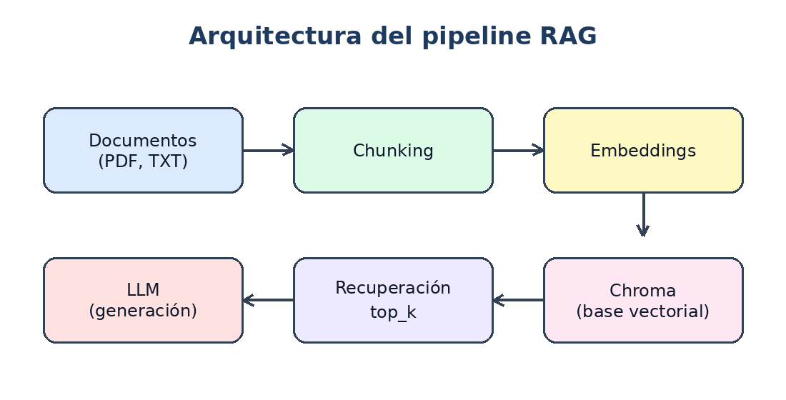

# Parte 1.1 — Pregunta sobre una imagen

- Fecha: 2026-11-11 12:24
- Modelo: `qwen/qwen3.8-27b`

## Imagen

## Pregunta

Describe qué muestra esta figura y explica qué conceptos de Creación de Aplicaciones con IA ilustra.

## Respuesta del modelo

## Qué muestra la figura

La imagen es un **diagrama de flujo** titulado *"Arquitectura del pipeline RAG"* (RAG = *Retrieval‑Augmented Generation*, o generación aumentada por recuperación). Representa el recorrido de los datos en una aplicación de IA que combina un modelo de lenguaje (LLM) con una base de conocimiento propia. El flujo se lee en dos "pistas":

1. **Pista de ingesta (arriba, de izquierda a derecha):**
   - **Documentos (PDF, TXT)** → **Chunking** → **Embeddings**
2. **Pista de consulta (abajo, de derecha a izquierda):**
   - **Embeddings** ↓ **Chroma (base vectorial)** → **Recuperación top_k** → **LLM (generación)**

En conjunto, el ciclo completo es: *se toman documentos → se fragmentan → se convierten en vectores → se guardan en una base vectorial → ante una pregunta se recuperan los fragmentos más parecidos (top‑k) → esos fragmentos se inyectan en el LLM para que genere la respuesta.*

## Conceptos de Creación de Aplicaciones con IA que ilustra

- **RAG como patrón de arquitectura.** Es el concepto central: en lugar de depender solo del conocimiento "memorizado" por el LLM, la aplicación *recupera* información relevante de una fuente externa y la *aumenta* al prompt. Esto es la técnica estándar para construir apps que respondan sobre datos privados, corporativos o actualizados.

- **Pipeline de ingesta (data pipeline).** Los nodos *Documentos → Chunking → Embeddings* muestran cómo se prepara el conocimiento antes de usarlo: se ingieren archivos (PDF, TXT), se **fragmentan** (*chunking*) en trozos manejables y se **vectorizan** (*embeddings*), transformando cada fragmento en un vector numérico que captura su significado semántico.

- **Chunking (fragmentación).** Ilustra que los documentos no se procesan enteros, sino en bloques de tamaño controlado, porque los modelos de embeddings y los contextos de los LLM tienen límites y porque fragmentos pequeños dan búsquedas más precisas.

- **Embeddings (representación vectorial).** Muestra la idea clave de que el texto se convierte en coordenadas numéricas en un espacio vectorial, de modo que la "similitud de significado" se pueda medir matemáticamente (distancia/coseno).

- **Base vectorial (Chroma).** Representa la capa de **almacenamiento y búsqueda por similitud**. Chroma es un ejemplo de *vector database* ligero, ideal para prototipos y apps de IA que necesitan indexar y consultar embeddings eficientemente.

- **Recuperación top‑k.** Ilustra la fase de *retrieval*: ante una consulta, el sistema busca los *k* fragmentos más similares al vector de la pregunta y los usa como contexto. El parámetro *k* es una decisión de diseño típica al construir estas apps (más contexto = más relevancia pero más coste/ruido).

- **LLM (generación).** El nodo final muestra que el modelo de lenguaje no "sabe" la respuesta por sí solo, sino que **genera** una respuesta coherente *condicionada* al contexto recuperado. Esto separa claramente las dos responsabilidades de la app: *buscar* (retrieval) y *redactar* (generation).

- **Separación de fases ingesta / consulta.** Al dibujar dos filas con direcciones opuestas, la figura enseña un principio de diseño importante: el trabajo de *preparar* el conocimiento (ingesta) es distinto del trabajo de *usarlo* en tiempo real (consulta), y una aplicación bien construida mantiene ambos pipelines separados.

## Por qué es relevante para crear aplicaciones con IA

Este diagrama resume el **esqueleto de una app de IA "con conocimiento propio"**: permite que un LLM responda sobre documentos del usuario o de la empresa, **reduce las alucinaciones** (porque la respuesta se ancla a fuentes recuperadas), **permite actualizar el conocimiento** sin reentrenar el modelo (solo se re‑indexan los documentos) y **facilita la trazabilidad** (se puede citar de qué fragmento vino la respuesta). En la práctica, construir una aplicación con IA moderna suele significar montar exactamente este pipeline: un módulo de ingesta que alimenta una base vectorial y un módulo de consulta que combina *retrieval* + *generación* con un LLM.
