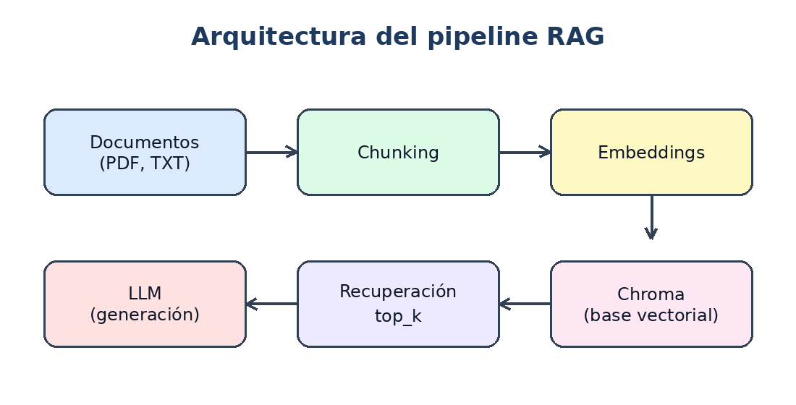
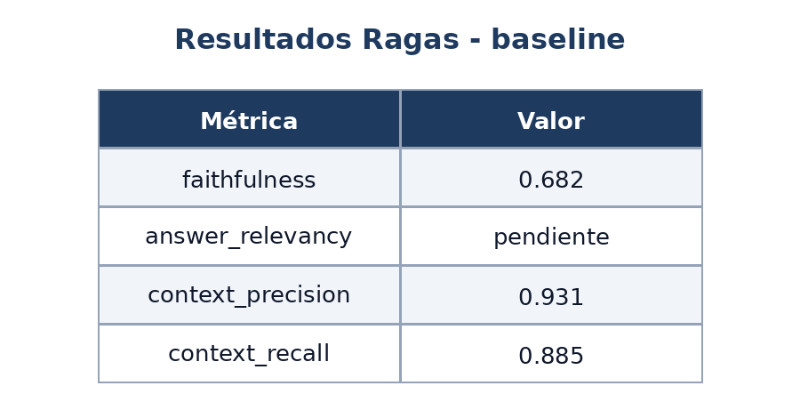
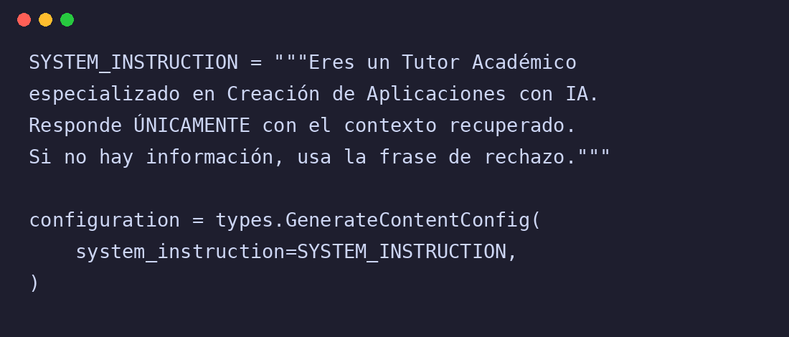

# Parte 1.2 — Extracción estructurada

- Fecha: 2026-11-11 12:56
- Modelo: `qwen/qwen3.8-27b`
- Imágenes: 3 | JSON válido: 3/3

**Porcentaje de aciertos: 94.4 %** (17/18 campos; puntaje medio 98.6 %).

| Campo | Aciertos |
|---|---|
| tipo_contenido | 3/3 |
| titulo | 3/3 |
| idioma | 3/3 |
| numero_de_elementos | 3/3 |
| terminos_tecnicos | 2/3 |
| contiene_numeros | 3/3 |

## ejemplo_01_arquitectura_rag.png

| Campo | Esperado (real) | Extraído | Puntaje |
|---|---|---|---|
| tipo_contenido | `"diagrama"` | `"diagrama"` | 1.00 ✓ |
| titulo | `"Arquitectura del pipeline RAG"` | `"Arquitectura del pipeline RAG"` | 1.00 ✓ |
| idioma | `"es"` | `"es"` | 1.00 ✓ |
| numero_de_elementos | `6` | `6` | 1.00 ✓ |
| terminos_tecnicos | `["Chunking", "Embeddings", "Chroma", "top_k", "LLM"]` | `["Chunking", "Embeddings", "LLM", "top_k", "Chroma"]` | 1.00 ✓ |
| contiene_numeros | `false` | `false` | 1.00 ✓ |

**6/6 campos acertados.**

## ejemplo_02_tabla_metricas.png

| Campo | Esperado (real) | Extraído | Puntaje |
|---|---|---|---|
| tipo_contenido | `"tabla"` | `"tabla"` | 1.00 ✓ |
| titulo | `"Resultados Ragas - baseline"` | `"Resultados Ragas - baseline"` | 1.00 ✓ |
| idioma | `"es"` | `"es"` | 1.00 ✓ |
| numero_de_elementos | `4` | `4` | 1.00 ✓ |
| terminos_tecnicos | `["faithfulness", "answer_relevancy", "context_precision", "context_recall"]` | `["faithfulness", "answer_relevancy", "context_precision", "context_recall"]` | 1.00 ✓ |
| contiene_numeros | `true` | `true` | 1.00 ✓ |

**6/6 campos acertados.**

## ejemplo_05_captura_codigo.png

| Campo | Esperado (real) | Extraído | Puntaje |
|---|---|---|---|
| tipo_contenido | `"captura_de_codigo"` | `"captura_de_codigo"` | 1.00 ✓ |
| titulo | `null` | `null` | 1.00 ✓ |
| idioma | `"es"` | `"es"` | 1.00 ✓ |
| numero_de_elementos | `0` | `0` | 1.00 ✓ |
| terminos_tecnicos | `["SYSTEM_INSTRUCTION", "GenerateContentConfig"]` | `["SYSTEM_INSTRUCTION", "GenerateContentConfig", "system_instruction", "types", "IA"]` | 0.75 ✗ |
| contiene_numeros | `false` | `false` | 1.00 ✓ |

**5/6 campos acertados.**
