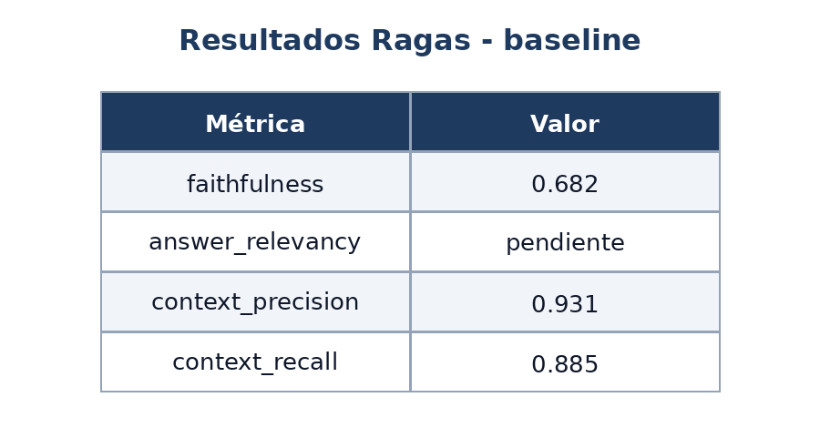
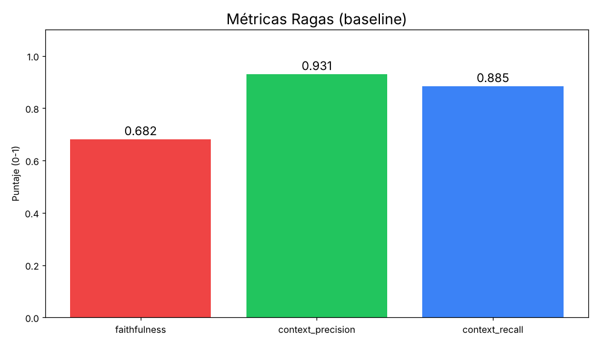

# Parte 1.3 — Varias imágenes en una solicitud

- Fecha: 2026-11-11 13:12
- Modelo: `qwen/qwen3.8-27b`
- Imágenes en la solicitud: 2

## Imágenes

## Pregunta

Estas imágenes están relacionadas. Compáralas: ¿qué tienen en común, en qué se diferencian y cómo se complementan para explicar un sistema de IA? Haz un resumen conjunto en pocas líneas.

## Respuesta del modelo

## Qué tienen en común
Todas las imágenes representan **la misma evaluación RAGAS de un sistema RAG en su configuración "baseline"**. Comparten exactamente las mismas métricas y los mismos valores numéricos: `faithfulness = 0.682`, `context_precision = 0.931` y `context_recall = 0.885` (y `answer_relevancy` como pendiente). Es decir, son distintas *vistas* de un único conjunto de resultados, no mediciones distintas.

## En qué se diferencian
- **Formato de presentación:** la primera imagen es una **tabla** (Métrica / Valor), mientras que las demás son un **gráfico de barras** con eje "Puntaje (0‑1)" y recortes/zooms de ambos.
- **Cobertura de métricas:** la tabla incluye las cuatro métricas, entre ellas `answer_relevancy` marcada como *pendiente*; el gráfico de barras **omite** esa métrica y solo grafica las tres que ya tienen valor.
- **Codificación visual:** el gráfico añade **color por métrica** (rojo = faithfulness, verde = context_precision, azul = context_recall) y una escala visual 0‑1, algo que la tabla no ofrece.
- **Nivel de detalle:** la tabla da el valor exacto y el estado de cada fila; el gráfico da la magnitud relativa y la comparación a simple vista.

## Cómo se complementan para explicar el sistema de IA
Juntas describen el **rendimiento de un pipeline RAG** (Recuperación + Generación) desde dos ángulos:
1. **La tabla** actúa como *registro formal*: lista cada dimensión de calidad (fiel al contexto, relevante a la pregunta, contexto preciso y contexto recuperado) y señala qué aún falta medir (`answer_relevancy` pendiente).
2. **El gráfico** actúa como *diagnóstico visual*: permite comparar de un vistazo qué sub‑componente funciona bien y cuál es el cuello de botella.

La lectura combinada revela el perfil del sistema: la **recuperación de contexto es fuerte** (`context_precision` 0.931 y `context_recall` 0.885, barras altas), pero la **generación es el punto débil** (`faithfulness` 0.682, barra roja más baja), lo que indica que el modelo alucina o no se apega del todo al contexto recuperado. Así, tabla + gráfico cuentan la misma historia: *el RAG recupera bien, pero genera con menor fidelidad*.

## Resumen conjunto (pocas líneas)
Las imágenes son dos representaciones (tabla y gráfico de barras) de la **misma evaluación RAGAS "baseline"** de un sistema RAG, con idénticos valores: `faithfulness 0.682`, `context_precision 0.931`, `context_recall 0.885` y `answer_relevancy` pendiente. La tabla aporta los valores exactos y el estado de cada métrica; el gráfico los compara visualmente con color y escala 0‑1. Juntas muestran que el sistema **recupera contexto con alta precisión y recall**, pero su **generación es menos fiel** (faithfulness más baja), identificando el área prioritaria de mejora.
